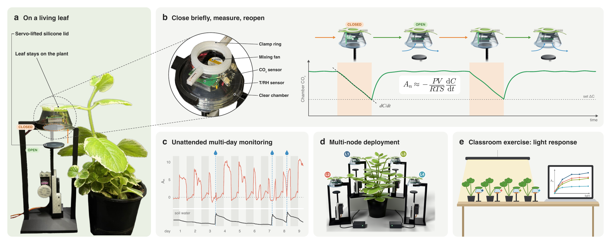

Paper on LeafBreath posted to arXiv: a low-cost, autonomous chamber that monitors photosynthesis on individual living leaves over multiple days.

**Read the paper:** [arXiv:2611.13387](https://arxiv.org/abs/2611.13387)

